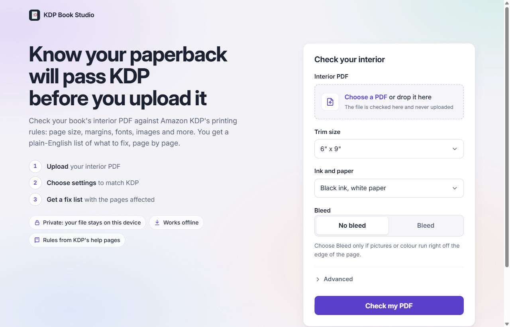
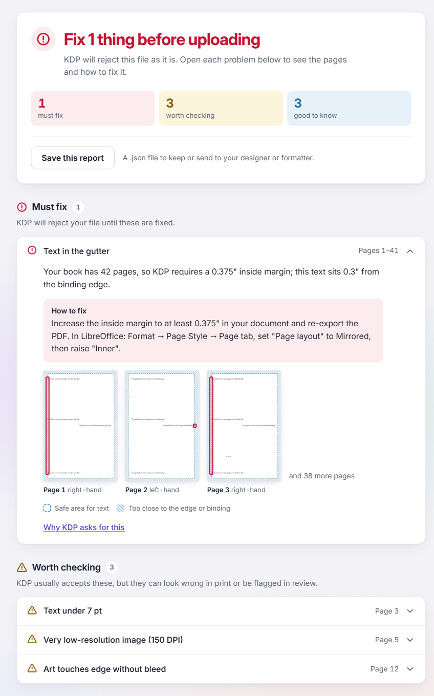
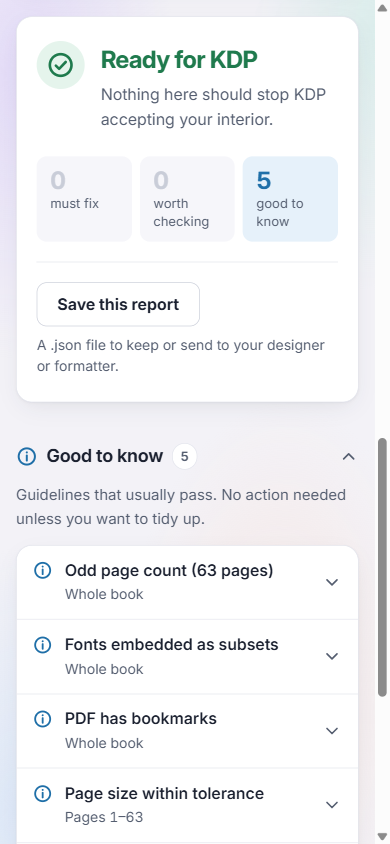

# KDP Book Studio: paperback interior preflight

Check a paperback interior PDF against Amazon KDP's printing rules **before** you upload it. You get a plain-English fix list, page by page. Everything runs in your browser and the PDF never leaves your device.

**Live:** https://kdp-book-studio-psi.vercel.app



## What it does

Self-published authors often find out about interior problems only when KDP rejects the file, or when the proof copy arrives with text lost in the binding. This tool runs the same kind of checks first and explains each problem in words a non-technical author can act on:

- **Page size** against the chosen trim size, with or without bleed. Spreads (two pages side by side) are detected.
- **Page count** against the allowed range for the trim size and ink/paper.
- **Margins**: text or art too close to the top, bottom, outside edge or binding. Margins are mirrored for left and right pages, and the gutter width depends on the page count.
- **Fonts**: every font embedded, including fonts inside placed PDFs. Text smaller than 7 pt is flagged.
- **Images**: the resolution of each image at its printed size (DPI).
- **Bleed**: art touching the edge without bleed, or art stopping short of the bleed edge.
- **Blank pages**: long runs of blank pages.
- **File rules**: locked or encrypted PDFs, the 650 MB limit, comments, form fields, JavaScript, links and bookmarks.

The report starts with the answer. A verdict card ("Ready for KDP" or "Fix 2 things before uploading") shows counts. Below it is one short row per problem: open a row to see the explanation, the fix (with LibreOffice steps), page previews with the problem outlined, and a link to the KDP help page behind the rule.

| Report on a book with problems | On a phone |
| --- | --- |
|  |  |

## Accuracy, stated honestly

The owner uses this on real books, so it doesn't claim more than it can do:

- **Severity follows what KDP actually does.**
  - *Must fix* is what KDP blocks: wrong size, text in the margins, unembedded fonts, page-count limits, encryption.
  - *Worth checking* is risky but usually accepted: low-resolution images, comments, art near the edge.
  - *Good to know* is guidelines that usually pass: links, bookmarks, subset fonts, an odd page count.
  - Only must-fix problems change the verdict. The tiers were tuned on a real LibreOffice book that KDP approved (5.512" x 8.5", with links, bookmarks and an odd page count).
- **Each result is labelled `verified` or `best-effort`.** Best-effort checks, such as text under 7 pt or art short of the bleed edge, say so in the report.
- **Our rules are marked as ours.** The 200 DPI "very low" threshold and the page-size tolerance (0.02" by default, adjustable) are this tool's settings, not KDP rules, and the report says so.
- **What it can't check reliably is listed** for the author to check by hand: crop marks, invisible objects, placeholder text and metadata.
- **Rules live in config, not code.** Every KDP number is in [`src/config/kdp-specs.json`](src/config/kdp-specs.json), with the source URL and the date it was last checked against Amazon's help pages.

## Privacy

- The PDF is read and rendered **on the device**, in a Web Worker. No upload, no server, no analytics.
- A strict **Content-Security-Policy** (`connect-src 'self'`, no third-party scripts, fonts or styles) means the browser itself blocks the page from sending the file anywhere.
- After the first visit it **works offline** and can be installed as an app (PWA). The Inter font is self-hosted for the same reason.

## Tech stack

- **Vite 5** + vanilla JavaScript (JSDoc types), with no UI framework.
- **pdf-lib** (MIT) reads the PDF structure: fonts, annotations, encryption, transparency.
- **pdfjs-dist** (Apache-2.0) renders pages to an `OffscreenCanvas` at 100 DPI to measure ink against margins. It also reads operator lists for image DPI and text positions for text vs art.
- **Web Worker** for the whole engine, so the page stays responsive on long books and progress is shown page by page.
- **vite-plugin-pwa** for offline use and installation. **Inter** via `@fontsource-variable/inter`.
- **Node tests**: 60 tests over PDFs generated with pdf-lib, including real embedded fonts. The engine has no DOM code, so the same code runs in the worker and in Node.
- Hosted on **Vercel**, with security headers in `vercel.json`.

## Run it locally

```
npm install
npm run dev       # open the local URL
npm test          # engine tests (Node 18+)
npm run build && npm run preview   # production build, served with the same security headers as Vercel
```

`npm run fixtures` writes the test PDFs to `tests/fixtures/out/`.

## Deploy (Vercel CLI)

```
npx vercel deploy          # preview URL: check it in the browser first
npx vercel deploy --prod   # production, only after the owner approves
```

## Where things live

- `src/config/kdp-specs.json`: every KDP rule, with source URL and last-verified date. Edit specs here only.
- `src/engine/`: PDF reading and checks (`checks/` has one file per check). No UI code.
- `src/worker/preflight.worker.js`: runs the engine off the main thread and posts progress and page thumbnails.
- `src/main.js`: the form, the worker and the progress bar.
- `src/ui/report.js`: the report.
- `src/ui/styles.css`: the styles.
- `public/pdfjs/`: pdf.js fonts, cmaps and image decoders. `npm run assets` copies them from node_modules; it runs before dev and build, and the folder is git-ignored.
- `PLAN.md`: the milestone plan. Phase 1 (interior preflight) is complete. Later phases cover a cover checker, a spine calculator and auto-fixes.

## License

MIT, see [LICENSE](LICENSE). KDP Book Studio is an independent tool, not made by or affiliated with Amazon.
